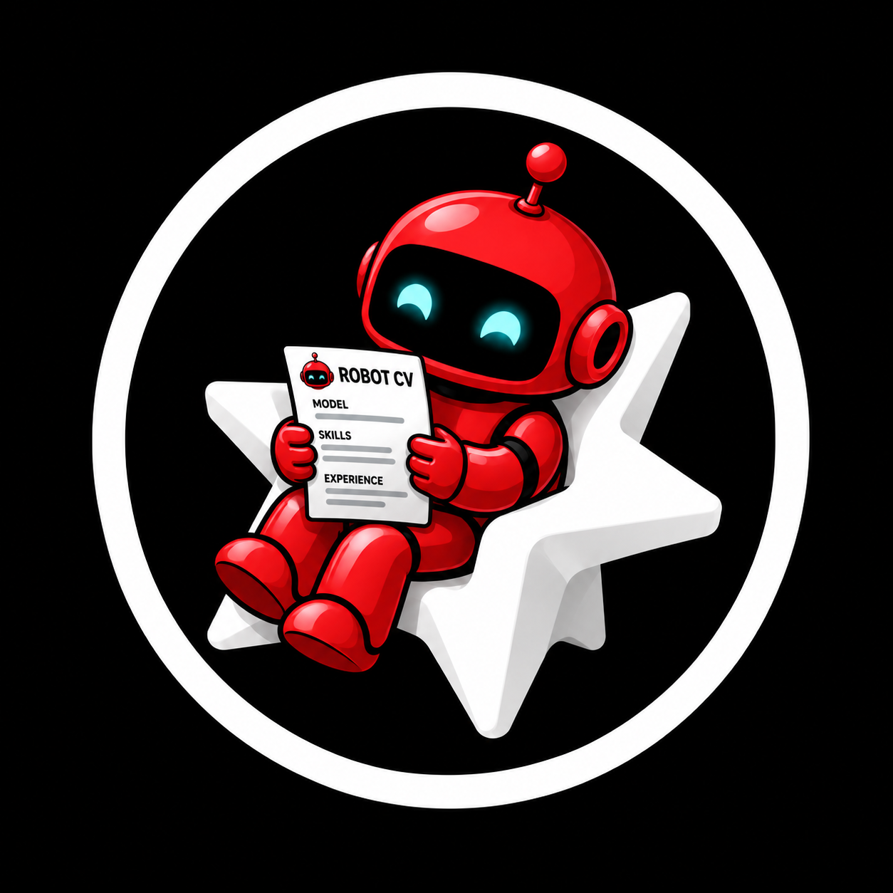

# VB CV Bot



Версия 0.1.0. Локальный плагин Codex для существующего Python-проекта `cv_bot`, который работает с вакансиями hh.ru. Плагин подключает проект, показывает сохранённую очередь и статистику, оценивает вакансии по его конфигу, готовит письма и проверяемые планы браузерных запусков.

Это адаптер: сам бот, персональный конфиг, резюме, база и браузерная сессия в пакет не входят. Существующий проект остаётся источником данных и выполнения команд.

## Установка в Codex

Репозиторий содержит локальный marketplace в `.agents/plugins/marketplace.json` с именем `vb-cv-bot-local`. Добавьте его командой:

```sh
codex plugin marketplace add /Users/victorbarskov/Developer/vb_cv_bot
```

Затем в управлении плагинами Codex выберите `vb-cv-bot` из этого marketplace и установите его. Это инструкция для пользователя: сам пакет не выполняет команду и не меняет глобальные настройки. Установка и активация в приложении — отдельный шаг.

Формат пакета описан в [официальном руководстве по плагинам Codex](https://developers.openai.com/plugins/build/plugins). Основные манифесты — `plugin.json` и `mcp.json`; `.codex-plugin/plugin.json` и `.mcp.json` оставлены для совместимости с загрузчиками прежнего формата.

Требования:

- Python 3.9+ для MCP-сервера: он использует только стандартную библиотеку.
- Существующий локальный `cv_bot` с модулями `hhbot` и подходящим `config.yaml`.
- Python окружение исходного проекта с его зависимостями. Установите их по README проекта, если они ещё не установлены; плагин не выполняет `pip install` автоматически.
- Google Chrome и Playwright исходного бота нужны для браузерных запусков. Для просмотра уже сохранённой очереди браузер не требуется.

## Первое подключение

Вызовите `$cv-setup` и укажите абсолютный путь к существующему `cv_bot`. Инструмент `cv_connect_workspace` сохраняет подключение в локальном состоянии адаптера. Можно передать `config_path` для другого конфига. `cv_status` проверяет доступность конфига и базы, показывает статистику. Он не проверяет запуск Chrome, наличие Playwright или действительность сессии hh.ru.

Переменные окружения:

| Переменная | Назначение |
| --- | --- |
| `VB_CV_BOT_HOME` | Каталог состояния адаптера. По умолчанию `~/.local/share/vb-cv-bot`. |
| `VB_CV_BOT_WORKSPACE` | Необязательный начальный путь к существующему `cv_bot`. |

Исходный `cv_bot` вычисляет относительные пути данных и профиля от своего корня. Подключение другого конфига само по себе не переносит эти каталоги к конфигу. Используйте осознанно выбранные пути исходного проекта.

## Возможности

| Запрос | Skill | MCP |
| --- | --- | --- |
| «Подключи cv_bot» | `$cv-setup` | `cv_status`, `cv_connect_workspace` |
| «Покажи лучшие вакансии» | `$cv-queue` | `cv_list_vacancies`, `cv_get_vacancy` |
| «Напиши письмо для этой вакансии» | `$cv-queue` | `cv_draft_letter` |
| «Оцени это описание по моему профилю» | `$cv-queue` | `cv_score_vacancy` |
| «Я отправил отклик, отметь» | `$cv-queue` | `cv_mark_vacancy` |
| «Подготовь поиск / вход / проверку / отклики» | `$cv-run` | `cv_prepare_run`, `cv_get_run` |

Чтение очереди обращается к существующей SQLite без запуска CLI бота и браузера. Письмо возвращается текстом в чат. `cv_mark_vacancy` меняет локальный статус, но ничего не отправляет на hh.ru. Оценка вакансии и подготовка письма используют правила подключённого проекта; скор не является вероятностью трудоустройства.

## Браузерные действия

`cv_prepare_run(action, limit?, min_score?, vacancy_ids?, letters?)` сохраняет план и возвращает его ID, команду, окружение и эффекты. Для проверки или отправки можно выбрать конкретные `vacancy_ids`; без этого параметра берутся верхние подходящие записи очереди. Для `apply` параметр `letters: [{vacancy_id, letter}]` фиксирует окончательный текст для каждой выбранной вакансии. Без него используется шаблон конфига. Черновики из `cv_draft_letter` не сохраняются для отправки автоматически.

Подготовка не открывает Chrome. План действует один час; runner сверяет исходный код, конфиг и выбранные вакансии. При изменениях нужен новый план. Проверить план и последующий результат можно через `cv_get_run`. Поле `browser_start_attempted` означает, что runner попытался запустить backend; оно не подтверждает открытие Chrome или доставку отклика.

Runner выполняется отдельно, после явного разрешения пользователя на конкретное браузерное действие:

```sh
python3 /absolute/path/to/plugin/scripts/run_action.py PLAN_ID --allow-browser
```

Для настоящих откликов нужен также `--allow-send`. Используйте точную команду и `runner_environment` из подготовленного плана: `VB_CV_BOT_HOME` должен указывать на состояние, где создан план. Передача флагов означает, что разрешение уже получено; сами флаги его не запрашивают. Создание или установка плагина не разрешают запуск Chrome или отправку откликов.

Действия: `login`, `search`, `check`, `apply`. `check` проверяет кнопку без клика. `apply` действительно отправляет отклики с резюме аккаунта по умолчанию; первый клик может отправить его сразу, без письма, даже если оно обязательно в конфиге. Это ограничение существующего backend. По умолчанию лимит плана — 3, максимум — 25, дополнительно действуют ограничения исходного конфига.

Для `login` нужен интерактивный терминал: при запуске через `exec_command` используйте `tty: true`, чтобы пользователь мог подтвердить вход. Капча останавливает прогон, автоматического продолжения после её решения нет. Уведомления через osascript и сохранение скриншотов в runtime-конфиге отключены. Запускать два процесса с одним профилем Chrome одновременно нельзя.

Плагин не устанавливает расписания, не запускает существующий `daily.sh` и не предоставляет online-редактирование резюме, `probe` или подтверждение телефона. Остановки и результаты описаны в [журнале действий](docs/action-log.md).

## Личные данные

Профиль `.chrome-profile*` содержит cookies; `data/` — базу, историю, логи и debug HTML/скриншоты; конфиг и резюме содержат данные соискателя. Они остаются в существующем проекте. Локальное состояние адаптера содержит выбранные пути и планы/результаты запусков. Не публикуйте его вместе с дистрибутивом.

Сервер предоставляет данные инструментам выбранного Codex-чата. Учитывайте это при выборе записей и текста, которые передаются в контекст. Плагин не содержит ключей и не запрашивает пароль от hh.ru: вход выполняется в браузере исходного бота.

## Структура

```text
plugin.json                    основной манифест плагина
mcp.json                       stdio MCP, python3
.agents/plugins/marketplace.json
.codex-plugin/plugin.json      совместимость
.mcp.json                      совместимость
scripts/mcp_server.py          локальные инструменты
scripts/run_action.py          отдельный runner подготовленного плана
skills/cv-setup/               подключение
skills/cv-queue/               очередь, скоринг, письма и отметки
skills/cv-run/                 планы и разрешённые запуски
```

## Локальная проверка

Из корня плагина: `python3 -B -m unittest discover -s tests -v`. Набор использует временные базы и подменённый backend, не запускает Chrome и не обращается в сеть. Соблюдайте требования вашего `AGENTS.md` к разрешению на запуск тестов.
